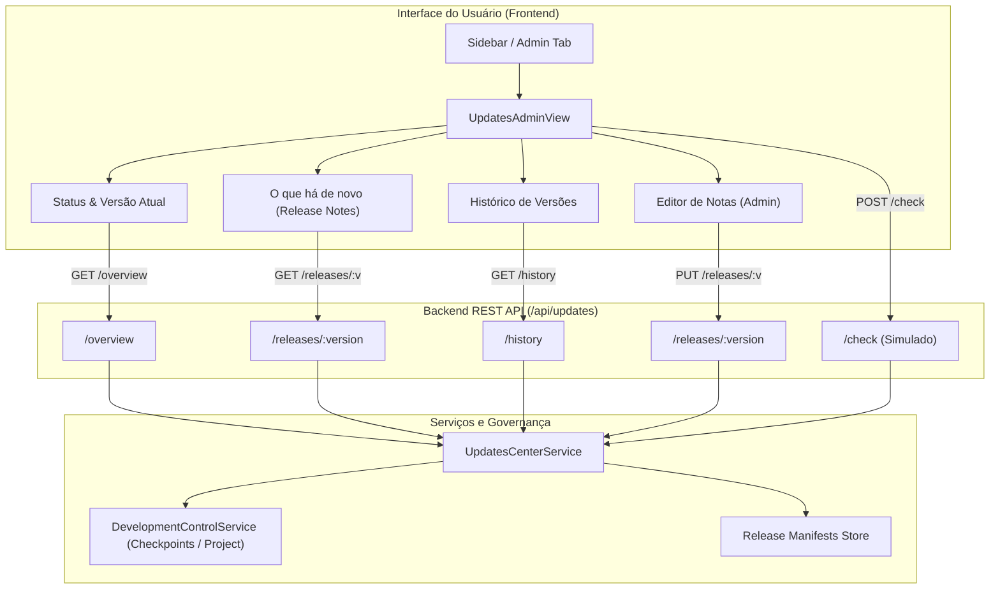
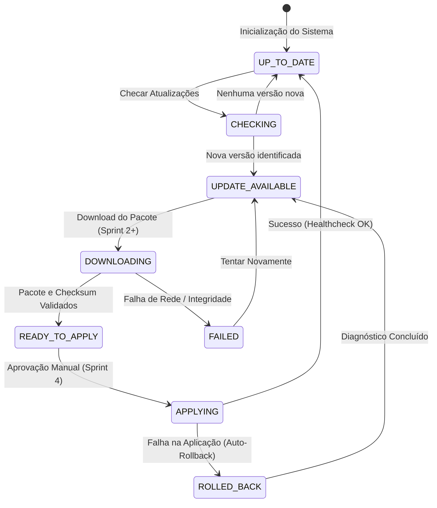

# Arquitetura da Central de Atualizações (Updates Center)

**Documento Canônico de Arquitetura e Governança**  
**Versão:** 1.0.0 — Sprint 1 (Fundação, Governança e Interface)  
**Data:** 2026-10-19  
**Status:** IMPLEMENTADO (Somente Ambiente de Desenvolvimento)

---

## 1. Inventário do Ecossistema Atual

A concepção da Central de Atualizações parte do inventário rigoroso dos componentes ativos da plataforma Witiquetas:

| Componente | Tecnologia | Papel Operacional | Status e Governança |
| :--- | :--- | :--- | :--- |
| **Frontend Comercial** | React 18, Vite 5, TypeScript | SPA de criação, gestão de modelos e administração multi-tenant. | Operacional no Shell (`ApplicationShell`). Possui abas de administração em `AdminPage`. |
| **Backend API** | Node.js 20, Express, TypeScript | API RESTful com autenticação por sessão, RBAC, filas e proxy de serviços. | Operacional. Expõe `/api/version`, `/api/health` e serviços de governança. |
| **RBAC & Autenticação** | Banco relacional + Session Cookie HttpOnly | Gestão de credenciais, sessões server-side, 25 permissões canônicas e 4 papéis padrão. | Ativo. Permissões `updates.view` e `updates.manage` incorporadas na Fase 5. |
| **DCC (Dev Control)** | JSON canônico + rotas `/api/development-control` | Rastreamento formal de fases, capabilities, métricas e checkpoints imutáveis. | Ativo em `docs/development-control/`. Integração direta com versionamento. |
| **Banco & Migrações** | PostgreSQL 14 (Alpine) | Persistência transacional com fila de impressão (011), RBAC (005) e configurações. | 11 migrações canônicas aplicadas sequencialmente em `apps/backend/src/migrations/`. |
| **GitHub Actions** | Workflows YAML (`docker.yml`) | CI com validação Windows PE x64, gate de integração PostgreSQL 14 e deploy manual. | Gate `deploy-production` estritamente condicionado a `workflow_dispatch` na `main`. |
| **GHCR** | GitHub Container Registry | Armazenamento de imagens imutáveis de Backend e Frontend. | Tags `candidate-${sha}`, `production-${sha}`, `stable` e `latest`. |
| **Docker Swarm / Host** | Traefik + Swarm + Portainer | Orquestração de containers de produção com terminação SSL e webhook do Portainer. | Produção estável no commit `8505ca5`. Webhooks protegidos por segredos. |
| **Agent Local** | Rust Core (x64 PE) | Daemon de hardware local para RAW TCP 9100 e spoolers locais de impressão. | Binário v0.2.0 instalado no Windows `SUPORTE-2`. |

---

## 2. Visão Geral da Central de Atualizações

A Central de Atualizações tem como finalidade proporcionar visibilidade, auditoria e controle sobre as versões da plataforma, permitindo a usuários e administradores:
1. Conhecer a versão atual, build, commit SHA e canal em execução.
2. Explorar o histórico cronológico de atualizações com changelog detalhado e notas de versão ("O que há de novo").
3. Identificar melhorias, correções, breaking changes e migrações necessárias para cada versão.
4. Cadastrar e ajustar notas de versão através de um editor administrativo integrado com pré-visualização em tempo real.
5. Preparar as fundações estruturais para verificação e orquestração de updates nas Sprints subsequentes, mantendo **risco zero** na Sprint 1.



---

## 3. Modelo de Estados da Atualização

A máquina de estados foi desenhada para cobrir o ciclo completo de vida de atualizações do sistema:



> [!IMPORTANT]
> **Escopo Restrito da Sprint 1:** Os estados operacionais ativos nesta sprint são `UP_TO_DATE`, `CHECKING` e `UPDATE_AVAILABLE`. Os estados de download, aplicação de containers e rollback estão desativados por design nesta fase.

---

## 4. Contratos e Manifesto de Release

Os contratos foram padronizados no pacote `@witiquetas/contracts` para garantir tipagem estrita compartilhada:

### 4.1. `ReleaseManifestDTO`
Representa a especificação completa de uma versão da aplicação:
```typescript
export interface ReleaseManifestDTO {
  manifestVersion: '1.0';
  version: string;                    // Ex: '5.7.1', '5.7.2'
  releaseDate: string;                 // ISO 8601
  channel: 'STABLE' | 'BETA' | 'NIGHTLY';
  type: 'MAJOR' | 'MINOR' | 'PATCH' | 'HOTFIX' | 'SECURITY';
  title: string;
  summary: string;
  changelogMarkdown: string;
  highlights: string[];
  breakingChanges: string[];
  requiredMigrations: string[];
  minAgentVersion?: string;
  components: {
    backendImage?: string;
    frontendImage?: string;
    agentWindowsSha256?: string;
    agentWindowsDownloadUrl?: string;
  };
  author: {
    name: string;
    email?: string;
  };
  createdAt: string;
  publishedAt?: string;
  status: 'DRAFT' | 'PUBLISHED' | 'ARCHIVED';
}
```

### 4.2. `UpdateCenterOverviewDTO`
Visão consolidada do estado atual da plataforma:
```typescript
export interface UpdateCenterOverviewDTO {
  currentVersion: {
    version: string;
    commit: string;
    shortCommit: string;
    builtAt: string;
    environment: string;
    package: string;
    phase: string;
  };
  channel: 'STABLE' | 'BETA' | 'NIGHTLY';
  status: 'UP_TO_DATE' | 'UPDATE_AVAILABLE' | 'DOWNLOADING' | 'READY_TO_APPLY' | 'APPLYING' | 'FAILED' | 'ROLLED_BACK';
  latestRelease?: ReleaseManifestDTO;
  hasUpdate: boolean;
  lastCheckedAt: string;
  historyCount: number;
  canManageUpdates: boolean;
  deployMechanismActive: boolean; // false na Sprint 1
}
```

---

## 5. Modelo de Permissões e Governança RBAC

Foram introduzidas duas permissões canônicas dedicadas no catálogo do sistema:

1. **`updates.view` ("Visualizar Atualizações")**:
   - **Descrição**: Permite consultar a versão em execução, histórico de versões, notas de versão e checagem de atualizações.
   - **Atribuída por padrão**: `ADMIN`, `SUPERVISOR`, `DESIGNER` e `PLATFORM_DEVELOPER`.
2. **`updates.manage` ("Gerenciar Atualizações")**:
   - **Descrição**: Permite editar notas de versão, gerenciar rascunhos de manifestos e alternar canais de atualização.
   - **Atribuída por padrão**: `ADMIN` e `PLATFORM_DEVELOPER`.

> [!NOTE]
> Requisições não autenticadas ou desprovidas das permissões necessárias recebem respostas estritas `401 Unauthorized` ou `403 Forbidden`, com logging de auditoria.

---

## 6. Salvaguardas da Sprint 1 e Não-Interferência

Para respeitar as diretrizes de desenvolvimento seguro da plataforma:
1. **Nenhum Docker / Portainer / Swarm Action**: O backend não invoca nenhum utilitário de terminal, nem efetua chamadas HTTP a webhooks de infraestrutura.
2. **Zero Regressão no Editor ou Impressão**: O Editor Visual, Compiladores e a Central de Impressão permanecem intocados e congelados.
3. **Respeito ao Multi-Tenancy**: Embora as informações de versão da plataforma sejam corporativas, notas de versão e permissões são autorizadas no nível de cada empresa/sessão.
4. **Isolamento de Segredos**: Nenhuma chave de API, credencial de banco ou segredo de CI/CD é exposto no manifesto ou nas rotas de updates.
