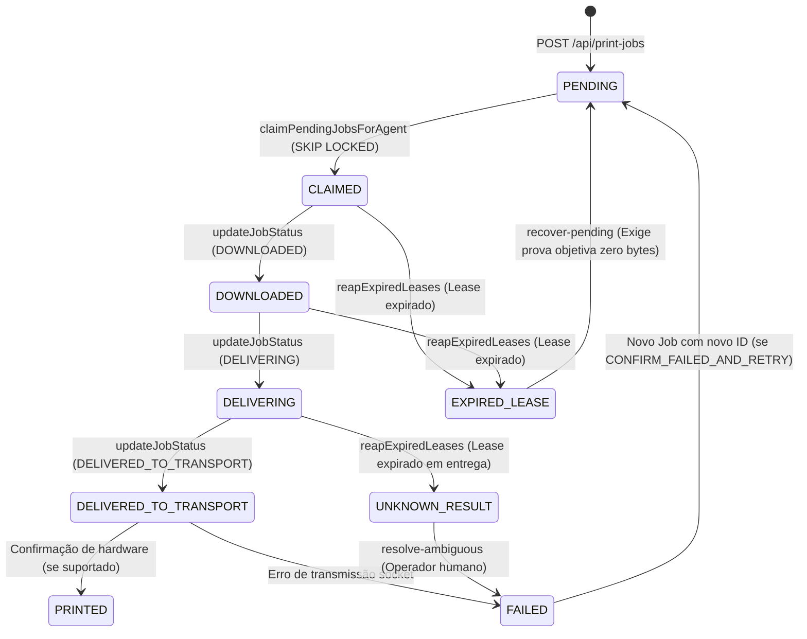

# WITIQUETAS — PACOTE 5.7.1: PLANO DE HOMOLOGAÇÃO NÃO FÍSICA E DEPLOY SEGURO
## FILA PERSISTENTE DE IMPRESSÃO, LEASE SAFETY E RECUPERAÇÃO TRANSACIONAL

> **Documento Canônico de Operações, Auditoria e Governança DCC**  
> **Status DCC:** `IMPLEMENTED_AWAITING_MANUAL_HOMOLOGATION`  
> **Branch de Validação:** `validation/package-5.7.1-postgres-gate`  
> **Commit Validado:** `904caa1b8036393d558dc4d15645de8b6f60f2fa`  
> **CI Run Homologado:** GitHub Actions Run `#198` — **SUCCESS**  
> **Banco de Dados:** PostgreSQL 14 (Testado em container real de serviço no GitHub Actions)  
> **Data:** 14 de Outubro de 2026  
> **Regra Suprema:** *PUSH != DEPLOY | BUILD VERDE != PRODUÇÃO | DEPLOY FÍSICO PROIBIDO NESTA ETAPA*.

---

## 1. ETAPA 1 — AUDITORIA DO CÓDIGO VALIDADO

A auditoria cobriu o commit `904caa1b8036393d558dc4d15645de8b6f60f2fa` em relação à baseline funcional de produção (`main`), verificando cada mecanismo implementado para a fila persistente:

| Item Auditado | Mecanismo Implementado | Arquivo / Linha | Evidência / Status |
| :--- | :--- | :--- | :--- |
| **1. Persistência de Jobs** | Gravação física em tabela `print_jobs` com status inicial `PENDING`, hash SHA-256 e payload Base64. | `apps/backend/src/repositories/printJobRepository.ts` | **CONFORME** (Gate B PASS no CI) |
| **2. Auditoria Append-Only** | Gravação imutável de todo evento de transição na tabela `print_job_events`. Proibido UPDATE/DELETE. | `printJobRepository.ts` (`INSERT INTO print_job_events`) | **CONFORME** (Gate G PASS: 5 eventos sequenciais) |
| **3. Atomicidade Transacional** | Blocos `BEGIN ... COMMIT` com rollback automático em caso de exceção. Nenhuma mutação parcial. | `printJobRepository.ts` | **CONFORME** (Gate F PASS: Rollback em erro) |
| **4. Idempotência por Tenant** | Índice parcial único `(company_id, idempotency_key)` e validação estrita de fingerprint físico de 6 parâmetros. | `printJobRepository.ts` (`checkIdempotencyMatch`) | **CONFORME** (Gates H & I PASS: Replay e 409) |
| **5. Multi-Tenancy Estrito** | Toda consulta, claim, auditoria e lock exige cláusula `WHERE company_id = $1`. Chaves não colidem entre tenants. | `printJobRepository.ts` | **CONFORME** (Gate L PASS: Alpha e Beta isolados) |
| **6. Concorrência Segura** | Claim concorrente via `FOR UPDATE OF j SKIP LOCKED` com ordenação determinística por `created_at ASC`. | `printJobRepository.ts` (`claimPendingJobsForAgent`) | **CONFORME** (Gates C & D PASS: 5 workers simultâneos, zero duplicação) |
| **7. Ownership e Leases** | Validação tripla obrigatória em mutações: `agentId` (403), `leaseId` (409) e `attemptId` (409). | `printJobRepository.ts` (`updateJobStatus`) | **CONFORME** (Gate F PASS: Agente 999 rejeitado) |
| **8. Lease Sweeper e Reaper** | Expiração automática de leases em background: `CLAIMED` vira `EXPIRED_LEASE`; `DELIVERING` vira `UNKNOWN_RESULT`. | `printJobRepository.ts` (`reapExpiredLeases`) | **CONFORME** (Gates J & K PASS) |
| **9. Fail-Closed sem Fallback** | Indisponibilidade do PostgreSQL interrompe operações imediatamente; proibido fallback silencioso em memória. | `printJobRepository.ts` (`if (pgPool) ... else throw`) | **CONFORME** (Gate M PASS: Fail-closed verificado) |
| **10. Compatibilidade Agent v0.2.0** | Agent Windows x64 em Rust consome envelopes JSON, envia `lease_id`/`attempt_id` e trata 403/409. | `apps/agent-core/src/runtime.rs` | **CONFORME** (Build PE x64 aprovado no CI) |

### 1.1 Diferenças entre a Branch de Validação e a Produção (`main`)
O `git diff main..HEAD` comprova alterações restritas a:
1. `.github/workflows/docker.yml`: Inclusão do container PostgreSQL 14 de serviço e execução do Gate dedicado.
2. `apps/backend/src/repositories/printJobRepository.ts`: Correção do SQLSTATE 42703 (`p.ip as printer_host`), sanitização de `copies` na checagem de idempotência e método seguro `cleanMemory/setPgPool`.
3. `tests/package571PostgresRealIntegration.test.ts` e adapters de teste (`tests/pg-adapter.js`, `tests/ts-loader.js`): Suíte de testes automatizados reais contra PostgreSQL 14.

**Conclusão da Auditoria:** Zero alterações em `@witiquetas/label-schema`, zero alterações no Frontend Editor, zero alterações no protocolo do Agent, zero alterações na Fase 6. O código está estritamente contido no escopo do Package 5.7.1.

---

## 2. ETAPA 2 — MIGRATION 011: PLANEJAMENTO E PROCEDIMENTO

### 2.1 Análise do Arquivo DDL (`011_create_persistent_print_queue_tables.sql`)
- **Tabelas Criadas:** `print_jobs` e `print_job_events`. Ambas são tabelas novas; nenhuma tabela de produção pré-existente (`companies`, `users`, `agents`, `printers`, `label_templates`) sofre alteração estrutural ou de colunas.
- **Constraints de Integridade:**
  - `print_jobs.company_id REFERENCES companies(id) ON DELETE CASCADE`
  - `print_jobs.printer_id REFERENCES printers(id) ON DELETE RESTRICT`
  - `print_jobs.claimed_by_agent_id REFERENCES agents(id) ON DELETE SET NULL`
  - `print_job_events.job_id REFERENCES print_jobs(id) ON DELETE CASCADE`
- **Índices Parciais:**
  - `idx_print_jobs_claim_queue`: Indexa apenas `WHERE status = 'PENDING'`. Não cresce com o histórico de impressões concluídas.
  - `idx_print_jobs_lease_sweeper`: Indexa apenas `WHERE status IN ('CLAIMED', 'DOWNLOADED', 'DELIVERING')`.
  - `idx_print_jobs_company_idempotency`: Garante unicidade `(company_id, idempotency_key) WHERE idempotency_key IS NOT NULL`.
- **Segurança de Reexecução:** Todas as instruções DDL utilizam `CREATE TABLE IF NOT EXISTS` e `CREATE INDEX IF NOT EXISTS`. A migration é 100% idempotente.
- **Impacto e Locks:** Como as tabelas são novas, o tempo de execução é inferior a 100 milissegundos. Não gera locks exclusivos em tabelas de produção existentes.

### 2.2 Checklist Pré-Migration
- [ ] Verificar integridade do cluster PostgreSQL de produção (`SELECT version();`).
- [ ] Executar backup completo via `pg_dump` antes de qualquer alteração:
  ```bash
  pg_dump -h $DB_HOST -U $DB_USER -d $DB_NAME -F c -b -v -f "/backups/pre-5.7.1-$(date +%Y%m%d%H%M%S).dump"
  ```
- [ ] Confirmar que o usuário da aplicação possui permissões de DDL (`CREATE TABLE`, `CREATE INDEX`) no schema `public`.
- [ ] Confirmar que as tabelas de referência existem: `companies`, `printers`, `agents`, `print_job_batches`.

### 2.3 Procedimento de Aplicação (Somente quando autorizado)
```bash
psql -h $DB_HOST -U $DB_USER -d $DB_NAME -f apps/backend/src/migrations/011_create_persistent_print_queue_tables.sql
```

### 2.4 Consultas SQL de Verificação Pós-Migration
```sql
-- 1. Verificar existência das tabelas
SELECT table_name FROM information_schema.tables 
WHERE table_schema = 'public' AND table_name IN ('print_jobs', 'print_job_events');
-- Esperado: 2 linhas

-- 2. Verificar índices parciais obrigatórios
SELECT indexname, indexdef FROM pg_indexes 
WHERE tablename = 'print_jobs' AND indexname IN (
  'idx_print_jobs_claim_queue',
  'idx_print_jobs_lease_sweeper',
  'idx_print_jobs_company_idempotency',
  'idx_print_jobs_company_created'
);
-- Esperado: 4 linhas

-- 3. Verificar integridade de foreign keys
SELECT conname, confrelid::regclass FROM pg_constraint 
WHERE conrelid = 'print_jobs'::regclass;
-- Esperado: FKs para companies, printers, agents, print_job_batches
```

### 2.5 Procedimento de Contingência (Sem DROP TABLE)
- Em caso de interrupção ou necessidade de rollback do backend:
  - **NÃO EXECUTAR DROP TABLE**. As tabelas vazias ou com jobs criados não causam conflito com versões anteriores do backend, pois versões anteriores não realizavam queries em `print_jobs`.
  - Manter as tabelas preservadas para posterior investigação forense.

---

## 3. ETAPA 3 — SEGURANÇA CONTRA IMPRESSÃO DUPLICADA

### 3.1 Máquina de Estados Persistente e Regras de Transição



### 3.2 Invariantes Físicas Obrigatórias (P0 Safety Rules)
1. **DELIVERING Antes dos Bytes:** O status `DELIVERING` precisa ser gravado no PostgreSQL e confirmado com HTTP 200 pelo backend antes de o Agent abrir a conexão TCP (`std::net::TcpStream::connect`) com a impressora.
2. **Timeout no Reporte Bloqueia Envio:** Se a requisição de atualização para `DELIVERING` sofrer timeout ou retornar erro, o Agent aborta a operação e NÃO transmite bytes à impressora.
3. **Lease Expirado em DELIVERING = UNKNOWN_RESULT:** Se um job em `DELIVERING` tiver seu lease expirado sem que o Agent tenha reportado o resultado, o lease sweeper o move compulsoriamente para `UNKNOWN_RESULT`.
4. **Proibido Retorno Automático:** Um job em `UNKNOWN_RESULT` **JAMAIS** retorna automaticamente para `PENDING`.
5. **Decisão Manual Explícita e Auditável:** Para resolver um `UNKNOWN_RESULT`, um operador humano autenticado deve inspecionar fisicamente a impressora e acionar `POST /api/print-jobs/:id/resolve-ambiguous` fornecendo justificativa mínima de 10 caracteres.
6. **Retry Gera Novo Job:** Quando a decisão for `CONFIRM_FAILED_AND_RETRY`, o job original é marcado imutavelmente como `FAILED`, e um novo registro independente com novo ID é inserido em `PENDING`.
7. **Semântica de DELIVERED_TO_TRANSPORT:** `DELIVERED_TO_TRANSPORT` certifica apenas que os bytes foram aceitos pelo socket TCP do dispositivo ou spooler local; não comprova saída de mídia física.
8. **Impossibilidade de Reimpressão por Sweeper:** O sweeper em background apenas transiciona jobs para `EXPIRED_LEASE` ou `UNKNOWN_RESULT`. Ele nunca cria novas tentativas e nunca reexecuta jobs.

---

## 4. ETAPA 4 — PLANO DE HOMOLOGAÇÃO NÃO FÍSICA

Todos os testes de homologação pré-deploy devem ser realizados em ambiente isolado (sem comunicação de rede com impressoras térmicas reais):

| Cenário | Pré-condições | Procedimento Operacional | Resultado Esperado | Evidência / Critério PASS |
| :--- | :--- | :--- | :--- | :--- |
| **A. Criação de Job** | Tenant ativo, impressora cadastrada. | Enviar `POST /api/print-jobs` com payload PPLB. | Job gravado em `print_jobs` com status `PENDING` e evento em `print_job_events`. | HTTP 201; SELECT confirma linha no banco; PASS. |
| **B. Restart do Backend** | Job criado em `PENDING`. | Reiniciar container do backend / encerrar pool de conexões. | Ao retornar, job continua `PENDING`, dados intactos, sem corrupção. | Consulta via API retorna os mesmos dados; PASS. |
| **C. Concorrência de Claim** | 10 jobs `PENDING` criados. | 5 chamadas simultâneas de claim para a mesma fila. | Cada worker recebe exatamente seus jobs sem repetição de IDs. | Zero IDs duplicados entre os 5 lotes; PASS. |
| **D. Falha de Banco** | Pool apontado para IP inacessível. | Tentar criar job ou reivindicar. | Erro explícito de banco lançado imediatamente sem fallback em memória. | Requisição falha com 500/503; memória vazia; PASS. |
| **E. Rollback em Falha** | Job em `CLAIMED` por Agente 1. | Agente 2 tenta transicionar job do Agente 1. | Backend recusa com 403 `NOT_CLAIM_HOLDER` e executa rollback. | Status permanece `CLAIMED` no Agente 1; PASS. |
| **F. Expiração de Lease** | Job em `CLAIMED` com lease expirado. | Executar ciclo do sweeper (`reapExpiredLeases`). | Job transiciona para `EXPIRED_LEASE`; evento registrado. | SELECT confirma `status = 'EXPIRED_LEASE'`; PASS. |
| **G. Resultado Ambíguo** | Job em `DELIVERING` com lease expirado. | Executar ciclo do sweeper. | Job transiciona obrigatoriamente para `UNKNOWN_RESULT`. | Status é `UNKNOWN_RESULT`; NÃO volta a `PENDING`; PASS. |
| **H. Idempotência por Chave** | Chave `idem-test-01`. | Enviar duas vezes o mesmo payload; enviar terceira vez com copies alterado. | 1ª: HTTP 201; 2ª: HTTP 200 (replay do mesmo ID); 3ª: HTTP 409 (mismatch). | IDs idênticos nas chamadas 1 e 2; erro 409 na 3; PASS. |
| **I. Isolamento Multi-Tenant** | Empresas Alpha e Beta com mesma chave. | Alpha cria job; Beta cria job com mesma Idempotency-Key. | Jobs criados com IDs distintos; Agent de Beta não enxerga jobs de Alpha. | Zero vazamento cruzado; PASS. |
| **J. Auditoria Append-Only** | Job percorre ciclo completo até transporte. | Consultar `GET /api/print-jobs/:id/events`. | 5 eventos em ordem cronológica estrita: PENDING, CLAIMED, DOWNLOADED, DELIVERING, DELIVERED. | Array com 5 itens imutáveis; PASS. |
| **K. Resolução Manual** | Job em `UNKNOWN_RESULT`. | Operador chama `resolve-ambiguous` com `CONFIRM_FAILED_AND_RETRY`. | Original vira `FAILED`; novo job com novo ID é criado em `PENDING`. | Original FAILED, novo PENDING com attempts 0; PASS. |
| **L. Compatibilidade Agent** | Daemon Rust compilado (PE x64). | Executar `--help` e simular handshake de polling. | Resposta compatível com envelopamento V1 e payload contracts. | Exit code 0, schema validado; PASS. |

---

## 5. ETAPA 5 — PLANO DE DEPLOY CONTROLADO

> [!IMPORTANT]
> **ESTE PLANO NÃO DEVE SER EXECUTADO NESTA SESSÃO.**  
> A execução requer aprovação formal prévia da governança.

### 5.1 Sequência Operacional Controlada (13 Passos)
1. **Confirmação do Commit:** Validar que o commit em staging corresponde a `904caa1b8036393d558dc4d15645de8b6f60f2fa`.
2. **Backup Pré-Deploy:** Executar `pg_dump` no banco de produção e armazenar o arquivo em local seguro.
3. **Verificação de Variáveis:** Confirmar que `DATABASE_URL` aponta para o cluster PostgreSQL de produção com credenciais válidas.
4. **Verificação de Permissões:** Validar permissão de DDL para o usuário da aplicação.
5. **Conferência de Migrations:** Verificar que as migrations 001 a 010 estão aplicadas no banco.
6. **Aplicação da Migration 011:** Executar o script `011_create_persistent_print_queue_tables.sql`.
7. **Validação do Schema:** Executar queries de verificação da Etapa 2.4.
8. **Promoção de Imagem:** Promover imagem imutável `ghcr.io/wittemberg/witiquetas-backend:candidate-904caa1` para `:production-904caa1` e atualizar a tag `:stable`.
9. **Disparo do Redeploy Portainer:** Acionar webhook do Portainer para atualizar o serviço `witiquetas_backend`.
10. **Validação de Healthcheck:** Consultar `GET https://witiquetas.wrtec.com.br/api/health` até obter `200 OK`.
11. **Validação de Versão em Produção:** Confirmar em `/api/version` que o commit em execução é exatamente `904caa1`.
12. **Smoke Tests Não Físicos:** Executar teste sintético de criação de job com tenant de teste, confirmando inserção relacional.
13. **Homologação Final:** Assinar o encerramento do deploy na governança DCC.

### 5.2 Critérios Objetivos de GO / NO-GO
- **Critérios para GO (Prosseguir):**
  - Backup do banco concluído com sucesso e verificado.
  - Migration 011 executada em menos de 1 segundo sem erros.
  - Endpoint `/api/health` retornando 200 OK em menos de 30 segundos após o redeploy.
  - Zero erros 500 no log do backend durante inicialização do pool PostgreSQL.
- **Critérios para NO-GO (Abortar Imediatamente e Conter):**
  - Falha de conexão com PostgreSQL na inicialização.
  - Divergência no commit reportado por `/api/version`.
  - Falha em qualquer das queries de validação de schema.
  - Crash ou reinicialização em loop do container Portainer.

---

## 6. ETAPA 6 — CONTINGÊNCIA E ROLLBACK NÃO DESTRUTIVO

| Cenário de Contingência | Ação Imediata de Contenção | Procedimento de Rollback | Preservação de Dados |
| :--- | :--- | :--- | :--- |
| **1. Migration Parcial** | Interromper aplicação; inspecionar `pg_stat_activity`. | Resolver lock pendente; reexecutar script (é idempotente). | Tabelas parciais mantidas; zero DROP. |
| **2. Backend Incompatível** | Reapontar tag `:stable` para a imagem anterior homologada (`5d2c2a236244cc333a5394b1af684bd43a84ab64`). | Acionar webhook do Portainer para subir a versão anterior. | Tabelas `print_jobs` e `print_job_events` permanecem intactas no banco. |
| **3. Falha de Conexão DB** | Verificar credenciais e conectividade de rede do container. | Se indisponibilidade do banco for persistente, parar backend para evitar estados inconsistentes (Fail-Closed). | Sem corrupção; dados preservados. |
| **4. Erro de Inicialização** | Capturar logs do container (`docker service logs witiquetas_backend`). | Rollback para imagem anterior via script de rollback. | Logs preservados para análise forense. |
| **5. Sweeper Anômalo** | Desativar temporariamente o job agendado via flag de configuração. | Inspecionar queries de sweep com `EXPLAIN ANALYZE`. | Zero perda de registros; auditoria preservada. |
| **6. Jobs Pendentes no Deploy** | Jobs `PENDING` permanecem seguros no PostgreSQL. | O novo backend assume a fila e continua o atendimento ordenado. | Zero perda de jobs pendentes. |
| **7. Jobs em DELIVERING no Deploy** | Conexões cortadas pelo restart expiram o lease. | Sweeper move para `UNKNOWN_RESULT`; operador avalia sem risco de duplicação. | Zero reimpressão automática descontrolada. |
| **8. Jobs em UNKNOWN_RESULT** | Registros isolados aguardando confirmação. | Manter bloqueados até decisão explícita via `resolve-ambiguous`. | Impossível reimpressão acidental. |

---

## 7. ETAPA 7 — GOVERNANÇA DCC

- **Pacote:** Package 5.7.1 — Persistent Print Queue & Lease Safety
- **Fase Atual:** Fase 5 — Administração e Governança da Aplicação
- **Baseline Validada:** Commit `904caa1b8036393d558dc4d15645de8b6f60f2fa`
- **Validação de CI:** GitHub Actions Run #198 — **100% SUCCESS**
- **Regressão Global:** 260/260 testes automatizados PASS
- **PostgreSQL Gate:** 11/11 subtestes PASS (PostgreSQL 14 real)
- **Status DCC Mantido:** `IMPLEMENTED_AWAITING_MANUAL_HOMOLOGATION`
- **Flag Deployed:** `false`
- **Próxima Etapa:** Execução dos 12 cenários de homologação não física pelo operador humano em ambiente controlado.

---

### DECLARAÇÃO DE ENCERRAMENTO DA TAREFA:
**`READY_FOR_CONTROLLED_HOMOLOGATION`**
