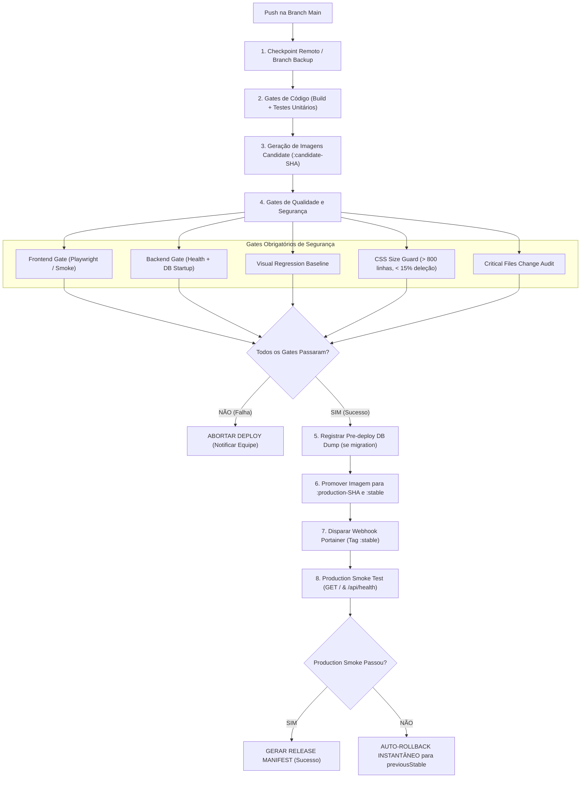
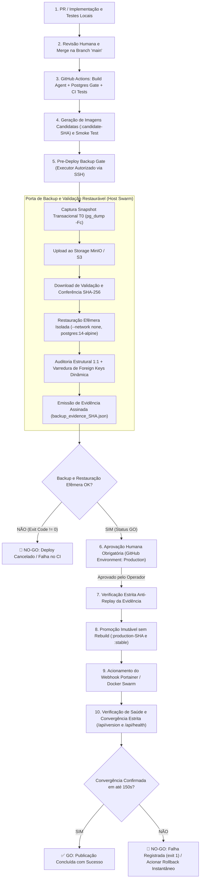

# RELEASE SAFETY & INSTANT ROLLBACK POLICY — WITIQUETAS

> **Documento Canônico de Operações e Segurança de Infraestrutura**  
> *Versão:* 1.0.0 — *Data de Vigência:* 21 de Agosto de 2026  
> *Regra Suprema:* **PUSH != DEPLOY**, **BUILD VERDE != PRODUÇÃO**, **LATEST PROIBIDO EM PRODUÇÃO**.

---

## 1. Princípios Fundamentais de Segurança

1. **Imutabilidade por SHA:** Nenhuma imagem ou container de produção deve utilizar a tag mutável `:latest`. Toda build gera artefatos identificados pelo SHA completo do commit Git (`backend:<FULL_SHA>` e `frontend:<FULL_SHA>`).
2. **Promotibilidade Candidate ➔ Stable:** As imagens construídas entram na fase de validação marcadas como `candidate-<SHORT_SHA>`. Apenas após a aprovação de **todos os gates automatizados** a imagem é promovida para `production-<FULL_SHA>` e a tag `stable` é atualizada.
3. **Rollback Instantâneo sem Rebuild:** Um rollback para a versão anterior (`previousStable`) **nunca exige recompilação de código**. As imagens das releases anteriores permanecem mantidas no GHCR e o rollback consiste no reapontamento atômico da tag `stable` e disparo de redeploy no Portainer.
4. **Proteção Automática de Banco de Dados:** Antes de qualquer implantação contendo migrações de banco de dados, um dump comprimido do PostgreSQL (`pg_dump`) é gerado automaticamente e armazenado no S3/MinIO.

---

## 2. Fluxo de Implantação e Gates de Segurança



---

## 3. Estrutura de Tags de Imagens no GHCR

| Ambiente / Fase | Formato da Tag | Mutabilidade | Descrição |
| :--- | :--- | :--- | :--- |
| **Build Candidate** | `ghcr.io/wittemberg/witiquetas-frontend:candidate-<SHORT_SHA>` | Imutável | Imagem gerada durante CI para execução de suítes de testes E2E. |
| **Produção SHA** | `ghcr.io/wittemberg/witiquetas-frontend:production-<FULL_SHA>` | Imutável | Imagem aprovada em todos os gates e pronta para audit/rollback. |
| **Produção Ativa** | `ghcr.io/wittemberg/witiquetas-frontend:stable` | Mutável (Ponteiro) | Tag referenciada pelo Portainer / Docker Swarm em produção. |

---

## 4. Política de Checkpoints e Retenção

### Checkpoints Locais e Remotos
- **Local (`.recovery/`):** Criado via `scripts/safety/create-checkpoint.ps1` antes de comitar ou alterar arquivos críticos. Guarda o manifesto `manifest.json`, diffs locais e tarball de untracked.
- **Remoto Automático (`backup/pre-push-YYYYMMDD-HHMMSS-<SHORT_SHA>`):** Branch criada no GitHub antes de todo push na `main`, salvaguardando o HEAD remoto exatamente antes das novas alterações.

### Retenção
- **Releases `stable` anteriores:** Mínimo de **10 releases imutáveis** mantidas no GHCR.
- **Checkpoints de homologação manual:** Não expiram.
- **Backups de Banco de Dados:** Retenção de 7 backups diários, 4 semanais e 3 mensais no MinIO/S3.

---

## 5. Rollback de Emergência e Incident Recovery

Em caso de qualquer anomalia em produção, execute o rollback em tempo **menor que 5 minutos**:

### Execução via PowerShell:
```powershell
.\scripts\release\rollback-production.ps1 -TargetSHA "previous"
```

### Execução via Bash / Linux:
```bash
./scripts/release/rollback-production.sh previous
```

O script identifica a release anterior registrada em `release-manifest.json`, reaponta a tag `stable` no GHCR para essa imagem imutável e aciona o webhook do Portainer para atualizar os serviços imediatamente.

---

## 6. Arquivos Críticos Monitorados (Critical File Guard)

Qualquer alteração nos seguintes arquivos dispara obrigatoriamente a suíte completa de regressão e auditoria visual:

- `apps/frontend/src/App.tsx`
- `apps/frontend/src/index.css`
- `apps/frontend/src/editor/EditorLayout.tsx`
- `apps/frontend/src/editor/CanvasArea.tsx`
- `apps/frontend/src/editor/PropertyInspector.tsx`
- `apps/frontend/src/editor/useEditorStore.ts`
- `apps/backend/src/index.ts`
- `packages/label-schema/src/index.ts`

---

## 7. Pipeline Definitiva de Publicação Automatizada

A plataforma Witiquetas opera sob um fluxo de entrega contínua com portas de segurança e isolamento transacional, eliminando a necessidade de comandos manuais repetitivos por parte do operador a cada publicação.



---

## 8. Demarcação Operacional: Configuração Única vs. Automação Definitiva

### A. Passos que Exigem Intervenção Humana UMA ÚNICA VEZ (Setup Inicial)

| Passo | Responsável | Ação Realizada | Frequência |
| :--- | :--- | :--- | :--- |
| **1. Provisionamento do Executor** | Operador no Host Swarm | Executar `sudo bash scripts/deploy/setup-authorized-executor.sh`. Cria o usuário `witiquetas-deployer`, pasta `/opt/backups/witiquetas` (750), chave SSH Ed25519 e regra sudoers restrita. | **Uma única vez** |
| **2. Cadastro de Secrets no GitHub** | Operador no GitHub | Cadastrar em *Settings ➔ Secrets and variables ➔ Actions*:<br>• `DEPLOY_HOST`: IP/DNS do servidor Swarm.<br>• `DEPLOY_USER`: `witiquetas-deployer`.<br>• `DEPLOY_PORT`: Porta SSH (padrão 22).<br>• `DEPLOY_SSH_KEY`: Chave privada Ed25519 gerada pelo script de setup.<br>• `MINIO_ACCESS_KEY_ID`: Chave de acesso MinIO da service-account.<br>• `MINIO_SECRET_ACCESS_KEY`: Segredo MinIO da service-account.<br>• `PORTAINER_WEBHOOK_URL`: URL do webhook de redeploy da stack Portainer. | **Uma única vez** |
| **3. Configuração do Ambiente Production** | Operador no GitHub | Em *Settings ➔ Environments ➔ production*, habilitar *Required reviewers* para garantir que o job `deploy-production` exija autorização humana formal antes de promover imagens e acionar o Portainer. | **Uma única vez** |

---

### B. Passos que Ficam Automatizados DEFINITIVAMENTE (A Cada Deploy)

| Etapa | Execução | Comportamento Automatizado |
| :--- | :--- | :--- |
| **1. Merge na Main** | GitHub Actions | Ao aprovar o PR, o pipeline dispara automaticamente sem necessidade de comandos no terminal. |
| **2. Compilação e Gates CI** | GitHub Actions | Compila o Agent Windows x64 (Rust PE), executa testes contra container PostgreSQL 14 de serviço e gera imagens candidatas com tag `:candidate-SHA`. |
| **3. Smoke Test de Candidato** | GitHub Actions | Sobe backend efêmero, valida `/api/health`, `/api/version` e download de binário de agente x64. |
| **4. Backup Pré-Deploy Automatizado** | Executor Autorizado | O GitHub Actions conecta via SSH restrito, executa `backup-and-validate-predeploy.sh`, envia para o MinIO com credenciais protegidas e valida a restauração em instância PostgreSQL efêmera isolada. |
| **5. Coleta e Validação de Evidência** | GitHub Actions | Transfere a evidência `backup_evidence_${COMMIT_SHA}.json`, valida que `status == "GO"`, vincula ao commit SHA e run ID atuais e anexa ao Step Summary. |
| **6. Pausa para Aprovação Humana** | GitHub Actions | O pipeline pausa no ambiente `production`. O operador apenas visualiza o resumo verde do backup e clica em **"Approve and deploy"**. |
| **7. Promoção Imutável e Webhook** | GitHub Actions | Após aprovação, promove as imagens sem rebuild (`docker buildx imagetools create`) para `:production-SHA`, `:stable` e `:latest`, e dispara o webhook do Portainer. |
| **8. Guarda Estrita de Convergência** | GitHub Actions | Monitora `https://witiquetas.wrtec.com.br/version.json` e `/api/version`. Se a stack convergir, emite relatório métrico GO. Se falhar após 150s, **falha compulsoriamente (exit 1)** para impedir falso positivo. |

---

## 9. Modelo de Permissões, Isolamento e Segurança

1. **Usuário de Serviço Dedicado e Menor Privilégio:**
   - O executor opera sob o usuário de sistema `witiquetas-deployer`.
   - Não possui shell de superusuário irrestrito.
   - Sudoers restrito exclusivamente à chamada canônica:
     `/etc/sudoers.d/witiquetas-deployer`:
     ```text
     witiquetas-deployer ALL=(root) NOPASSWD: /opt/witiquetas/scripts/backup-and-validate-predeploy.sh
     ```
2. **Isolamento de Chaves SSH:**
   - Chave Ed25519 configurada no `authorized_keys` com restrições defensivas:
     `no-port-forwarding,no-X11-forwarding,no-agent-forwarding`.
3. **Proteção Rigorosa de Segredos MinIO:**
   - Credenciais MinIO (`AWS_ACCESS_KEY_ID`, `AWS_SECRET_ACCESS_KEY`) são injetadas exclusivamente em memória via variáveis de ambiente da sessão SSH protegida pelo GitHub Actions.
   - **Zero segredos salvos em disco**, arquivos de configuração do host, logs de build ou repositório Git.
4. **Isolamento da Instância Efêmera de Restauração:**
   - O teste de restauração roda em um container descartável `postgres:14-alpine` configurado com `--network none` (isolamento total de rede), autenticação local `trust` para socket interno, sem portas expostas e sem volumes de produção montados.
   - A base de dados de produção é acessada **estritamente em modo leitura** (`pg_dump` e consultas de catálogo `information_schema`/`pg_catalog`).
5. **Garantia Anti-Replay de Evidências:**
   - O deploy em produção valida se a evidência contém `targetCommitSha` idêntico a `${{ github.sha }}` e `workflowRunId` idêntico a `${{ github.run_id }}`. É impossível reutilizar evidências de commits anteriores ou de outros runs.
